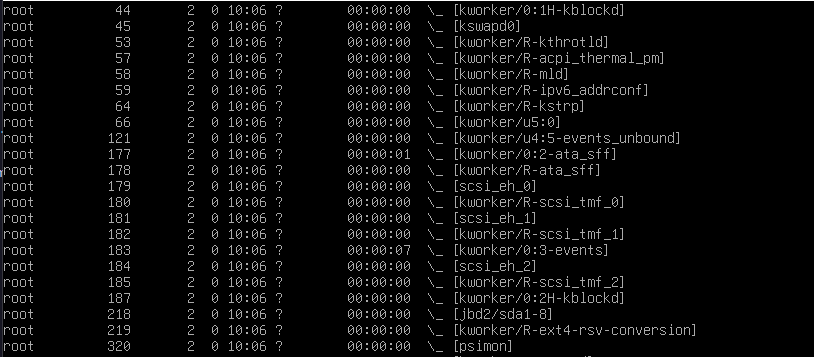
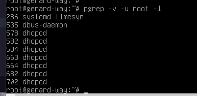
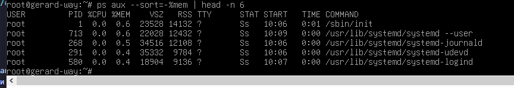
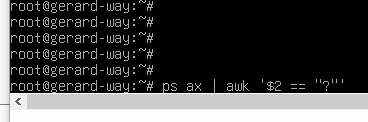
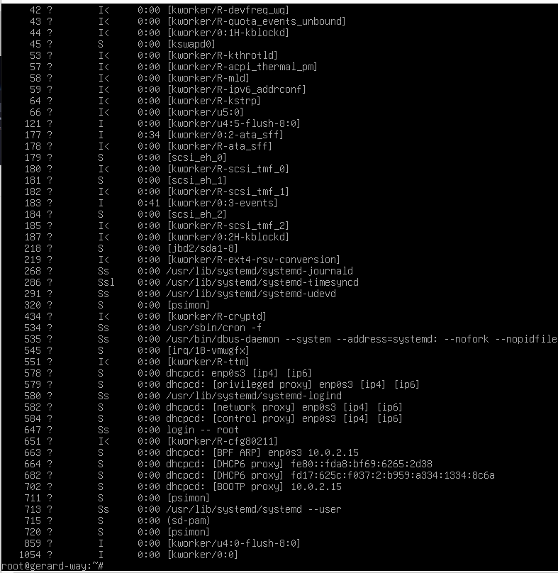
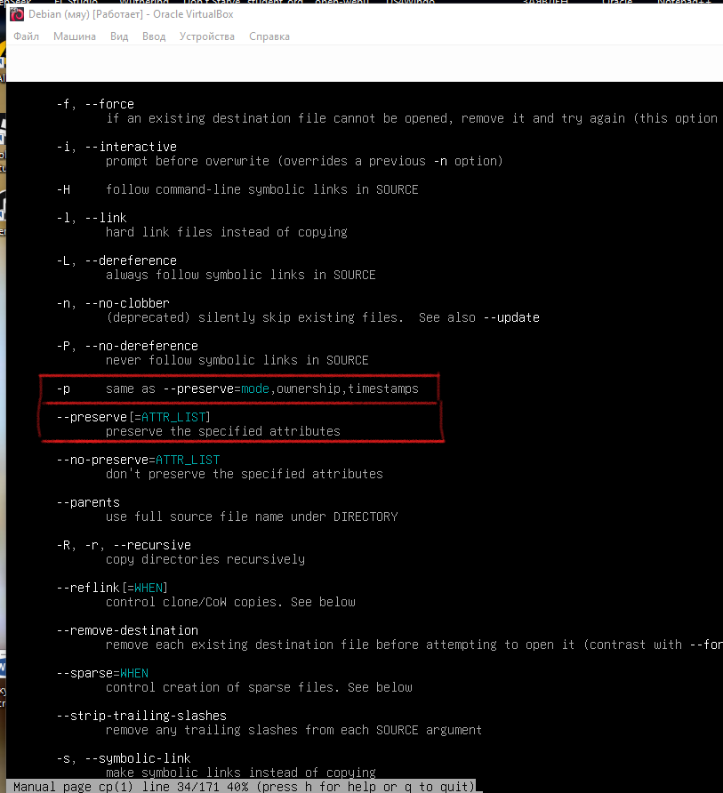
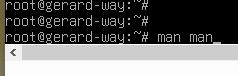
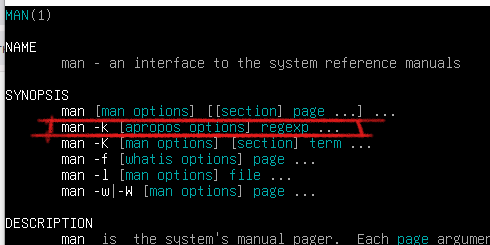
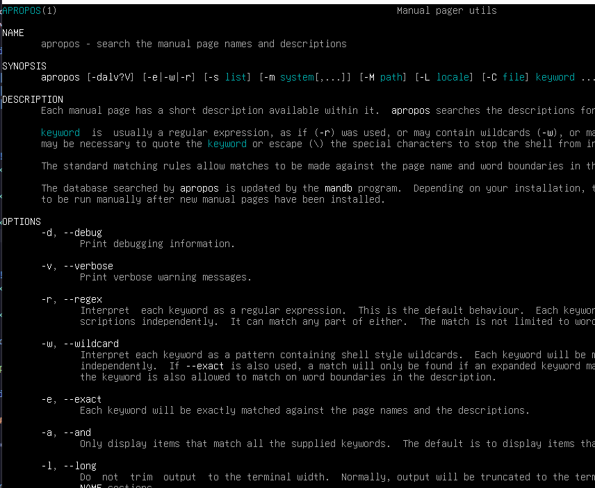
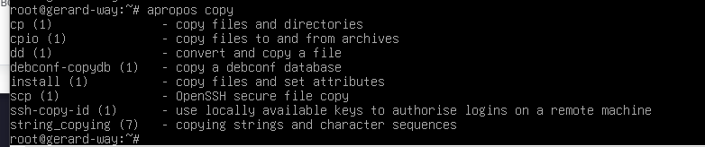

# ДОМАШНЕЕ ЗАДАНИЕ
## ПО ДИСЦИПЛИНЕ «ОПЕРАЦИОННЫЕ СИСТЕМЫ И СРЕДЫ»
### **Тема: «Администрирование»** 

>Практика по командам взаимодействия с процессами и справочной информации man

| | |
| :--- | :--- |
| Студент: | Станчинская София Антоновна |
| Группа: | 9/2-РПО-25/3 (РПО9-3) |
| Дата: | 17.10.2026 |
| Преподаватель: | Штейнберг Эмиль Эдуардович |

## **Задание 1. <u>Практика по командам</u>**

### **1.1.**

* ☼ Отобразите процессы в виде дерева (иерархия с обозначением процессов-родителей и процессов потомков). С помощью каких аргументов это можно сделать?

  | | |
  |:---|:---|
  |`ps`| выводит снимок текущих процессов `ps [option ...]`|
  |ps `-e`| (everithing/everyone) выбрать все процессы. аналогично -A. |
  |ps `-f`| (full) выполняет вывод в полном формате. |
  |ps `--forest`| дерево процессов в формате ASCII-графики. |

    ps -e -f --forest

  
   

  <small><em>Рисунок 1.1. команда, ps </em></small>

   

  
   

  <small><em>Рисунок 1.2. вывод </em></small>

### **1.2.**

* ☼ Найдите все процессы, запущенные не от имени вашего пользователя (root).

  | | |
  |:---|:---|
  |`pgrep`| поиск процессов на основе имени и других атрибутов |
  |pgrep `-v`| (--inverse) инвертирует условие сопоставления. |
  |pgrep `-u`| (--euid) выбирать только те процессы, эффективный идентификатор пользователя (EUID) которых указан в списке. |
  |pgrep `-l`| (-list-name) выводить имя процесса наряду с его идентификатором (PID). (Только для pgrep.) |

    pgrep -v -u root -l

 
<small><em>Рисунок 2. команда, вывод, pgrep </em></small>

### **1.3.**

* ☼ Выведите пять процессов, потребляющих больше всего памяти. Для ограничения количества процессов используйте команду head.

  | | |
  |:---|:---|
  |`a`| (all) снимает ограничение «показывать только процессы текущего пользователя» |
  |`u`| (user-oriented) отображать в формате, удобном для пользователя. |
  |`x`| (extended) снимает ограничение «процесс обязательно должен быть привязан к терминалу» |
  |`--sort`| задает порядок сортировки. Синтаксис сортировки:  `[+\|-]key[,[+\|-]key[,...]]` |
  |`-`| от большего к меньшему |
  |`%mem`|  процент оперативной памяти компьютера, который процесс занял прямо сейчас |

    ps aux --sort=-%mem | head -n 6

 
<small><em>Рисунок 3.  команда, вывод, ps </em></small>

### **1.4.**

* ☼ Выведите все процессы, запущенные в фоновом режиме.

  | | |
  |:---|:---|
  |`awk`| язык для поиска и обработки шаблонов |
  |`'$2'`| смотреть строго во второй столбец  |
  |`'== "?"'`| показать только те строки, где написан знак вопроса  |

    ps ax | awk '$2 == "?"'

  
   

  <small><em>Рисунок 4.1. команда </em></small>

   

  
   

  <small><em>Рисунок 4.2. вывод </em></small>

### **1.5.**

* ☼ Откройте справочную страницу команды cp. Найдите аргумент, который позволяет при копировании сохранить владельца, права и временные метки файла.

  | | |
  |:---|:---|
  |`man`| открытие справочной страницы |
  |cp `-p`| (--preserve) копирование с сохранением владельца, прав и времени |

    man cp

  
   

  <small><em>Рисунок 5.1. команда </em></small>

   

  
   

  <small><em>Рисунок 5.2. вывод </em></small>

### **1.6.**

* ☼ Откройте справочную страницу команды man. Какой аргумент позволяет искать справки не по точному названию, а по ключевым словам?

  | | |
  |:---|:---|
  |man `-k`| открытие справочной страницы по ключевым словам |

    man man

  
   

  <small><em>Рисунок 6.1. команда </em></small>

   

  
   

  <small><em>Рисунок 6.2. вывод </em></small>

### **1.7.**

* ☼ Найдите команду, которая делает то же самое, что в предыдущем задании. С помощью нее найдите все известные справочные страницы по ключевому слову copy.

  | | |
  |:---|:---|
  |`apropos`| поиск справочных страниц по ключевым словам |

    man apropos

  
   

  <small><em>Рисунок 7.1. man </em></small>

   

    apropos copy

  
   

  <small><em>Рисунок 7.2. команда + вывод </em></small>

  ## **ВЫВОДЫ**

  **В процессе выполнения домашнего задания были изучены команды `ps`, `pgrep`, `awk`, `cp`, `man`, `apropos`. Благодаря им можно управлять процессами, выводить их дерево, топ по потреблению опредленного железа, а также быстро осуществлять поиск нужной справочной информации по ключевым словам. Эти навыки пригодятся для мониторинга состояния системы и эффективного администрирования процессов в Linux.**

