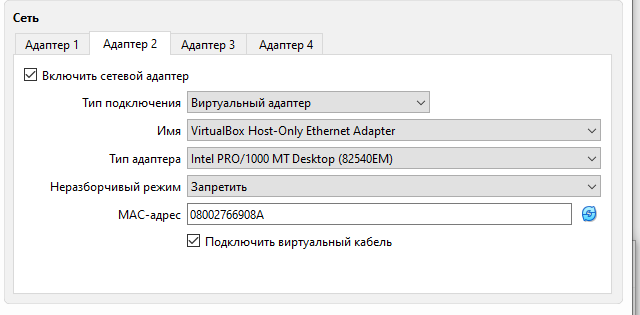
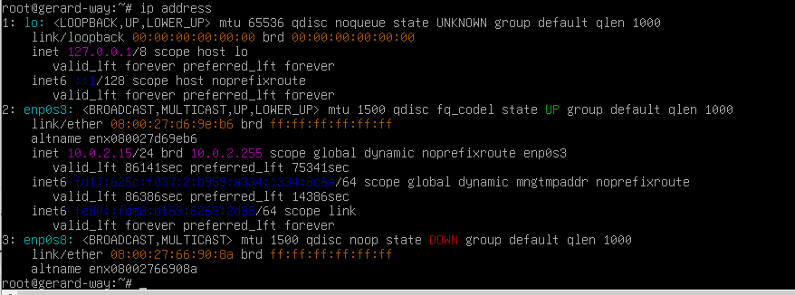
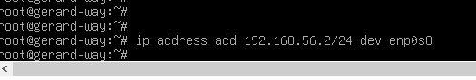
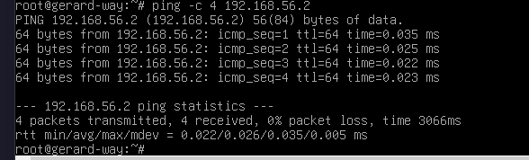
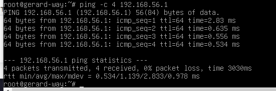
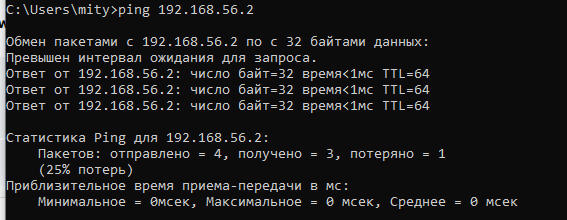

# ДОМАШНЕЕ ЗАДАНИЕ
## ПО ДИСЦИПЛИНЕ «ОПЕРАЦИОННЫЕ СИСТЕМЫ И СРЕДЫ»
### **Тема: «Администрирование 2: возвращение сети»** 

>Практика по командам ip и ping для управления сетью

| | |
| :--- | :--- |
| Студент: | Станчинская София Антоновна |
| Группа: | 9/2-РПО-25/3 (РПО9-3) |
| Дата: | 17.10.2026 |
| Преподаватель: | Штейнберг Эмиль Эдуардович |

## **Задание 1. <u>Практика по командам</u>**

### **1.1.**

* ☼ Давайте подключим к виртуальной машине адаптер, который позволит обмениваться данными между гостевой машиной и хост-машиной. Для этого в настройках виртуальной машины нужно активировать второй адаптер с типом Виртуальный адаптер и именем VirtualBox Host-Only Ethernet Adapter.

  
   
  <small><em>Рисунок 1. Настройка Адаптера 2 </em></small>

### **1.2.**

* ☼ Введите команду ip address. Что вы увидели?

    ip address

 
<small><em>Рисунок 2. Команда показала три сетевых адаптера. lo, enp0s3 и новый enp0s8 </em></small>

### **1.3.**

* ☼ Установите на третьем адаптере любой незанятый подсети адрес из той же, что и ваша хост-машина. По умолчанию, для виртуального адаптера VirtualBox выделена сеть 192.168.56.0, а сама хост машина имеет адрес 192.168.56.1.

    ip address add 192.168.56.2/24 dev enp0s8

 
<small><em>Рисунок 3. добавления адреса 192.168.56.2 с маской /24 к enp0s8 </em></small>

### **1.4.**

* ☼ Проверьте связь с самим собой — то есть с адресом, который вы выставили на адаптере.

  | | |
  |:---|:---|
  |`-с`| завершить работу после отправки указанного количества (count) пакетов ECHO_REQUEST. |
  
    ping -c 4 192.168.56.2

 
<small><em>Рисунок 4. ping самому себе, успешно </em></small>

### **1.5.**

* ☼ Аналогичным образом проверьте связь с хост-машиной. Используйте адрес адаптера на хост-машине (по умолчанию — 192.168.56.1).

    ping -c 4 192.168.56.1

 
<small><em>Рисунок 5. ping хост-машине, успешно </em></small>

### **1.6.**

* ☼ Теперь попробуйте выполнить проверку связи из хост-машины в гостевую путем использования командной строки на операционной системе хост-машины.

    ping 192.168.56.2

 
<small><em>Рисунок 6. ping из Windows в Debian </em></small>

  ## **ВЫВОДЫ**

   **В процессе выполнения домашнего задания были изучены команды `ip` и `ping`, настройки сетевых адаптеров в среде VirtualBox. Благодаря им можно просматривать доступные интерфейсы в Debian, присваивать им новые IP-адреса, включать сетевые устройства и проверять связь между гостевой операционной системой и хост-машиной Windows. Эти знания необходимы для конфигурирования сети и диагностики подключений в Linux.**

