

# ДОМАШНЕЕ ЗАДАНИЕ
## ПО ДИСЦИПЛИНЕ «ОПЕРАЦИОННЫЕ СИСТЕМЫ И СРЕДЫ»
### **Тема: «Приложения»** 

>Использование мультиплексора

| | |
| :--- | :--- |
| Студент: | Станчинская София Антоновна |
| Группа: | 9/2-РПО-25/3 (РПО9-3) |
| Дата: | 17.10.2026 |
| Преподаватель: | Штейнберг Эмиль Эдуардович |

## **Задание 1. <u>Практика по командам</u>**

### **1.1.**

* ☼ Установите в системе консольный мультиплексор tmux.

  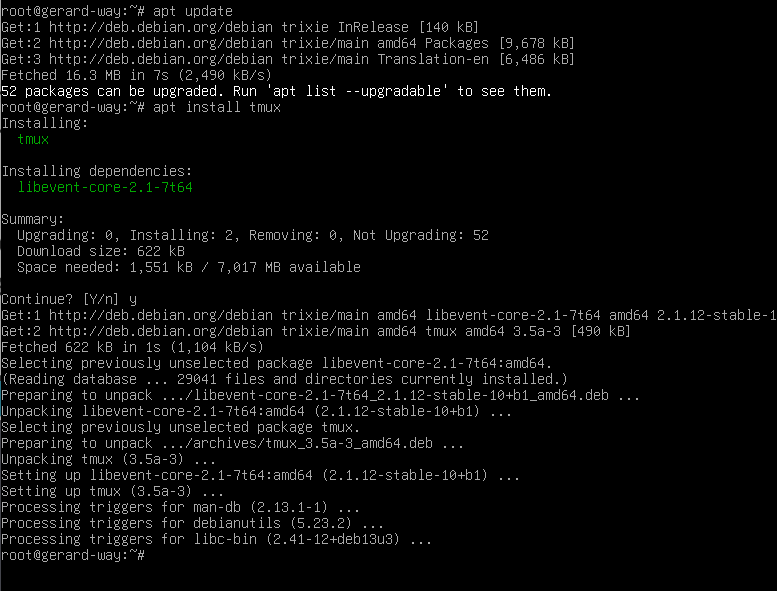
   
  <small><em>Рисунок 1. установка tmux </em></small>

### **1.2.**

* ☼ Запустите консольный мультиплексор. Чем отличается окно от обычного терминала?

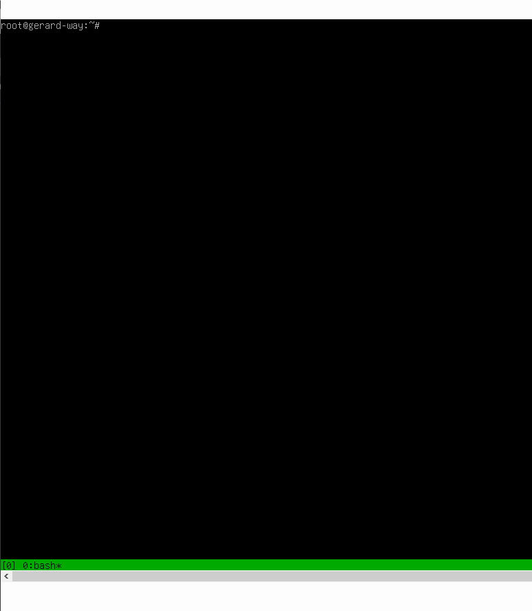
 
<small><em>Рисунок 2. запуск tmux. Появился зелёный статус-бар внизу экрана.</em></small>

### **1.3.**

* ☼ Создайте новое окно с помощью последовательного нажатия комбинации клавиш Ctrl + B и клавиши C. В зеленой строке снизу должно быть две позиции.

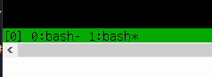
 
<small><em>Рисунок 3. 1:bash* </em></small>

### **1.4.**

* ☼ Переименуйте текущее окно в Text и запустите в нем vim. Для переименования используйте последовательное нажатие Ctrl + B и клавиши , (запятая).

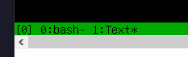
 
<small><em>Рисунок 4. переименовано в Text </em></small>

### **1.5.**

* ☼ В окне в vim напишите скрипт на Python для последовательной записи в файл test.txt количества секунд с его запуска, каждое значение в новой строке.

  | | |
  |:---|:---|
  |`import time`| импорт библиотеки time |
  |`i = 1`| переменная i = 1 |
  |`while True:`| бесконечный цикл |
  |`time.sleep(1)`| функция sleep из библиотеки time (ожидать секунду) |
  |`print(i, file=open("test.txt", "a"), flush=True)`| напечатать i в файл = (открыть файл test.txt, в режиме append), сохранить мгновенно|
  |`i += 1`| переменную i увеличить на 1|

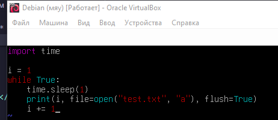
 
<small><em>Рисунок 5. скрипт в vim </em></small>

### **1.6.**

* ☼ Запустите скрипт с помощью команды python3 {имя_скрипта}

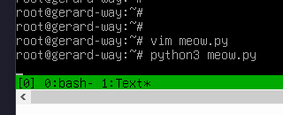
 
<small><em>Рисунок 6. скрипт запущен </em></small>

### **1.7.**

* ☼ Перейдите в предыдущее окно с помощью последовательного нажатия Ctrl + B и клавиши 0 (ноль).

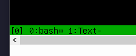
 
<small><em>Рисунок 7. переход в окно 0 </em></small>

### **1.8.**

* ☼ С помощью команды watch следите за изменением размера файла test.txt.

  | | |
  |:---|:---|
  |`watch`| периодически выполнять программу, отображая вывод в полноэкранном режиме |
  |`-n`| (--interval) указать интервал обновления.|

    watch -n 1 ls -l test.txt

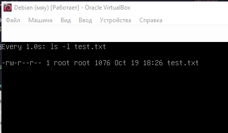
 
<small><em>Рисунок 8. watch </em></small>

### **1.9.**

* ☼ Завершите работу watch и отправьте сигнал прерывания в скрипт на Python. Перейдите в первое окно, последовательно нажав Ctrl + B и клавишу 1.

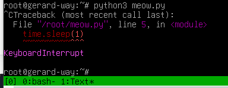
 
<small><em>Рисунок 9. скрипт и watch прерваны </em></small>

### **1.10.**

* ☼ Закройте второе окно командой exit.

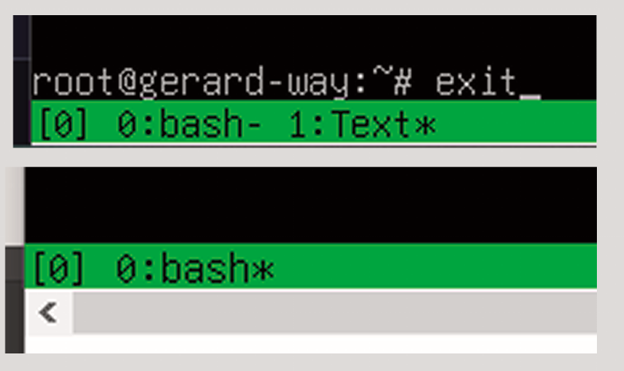
 
<small><em>Рисунок 10. окно Text закрыто </em></small>

### **1.11.**

* ☼ Разделите оставшееся окно по горизонтали с помощью Ctrl + B и клавиши %. Переход между областями осуществляется с помощью Ctrl + B и клавиш стрелок. Запустите установку пакета fastfetch в правой области.

  >% разделил по вертикали, а не по горизонтали, но так и удобней хехе

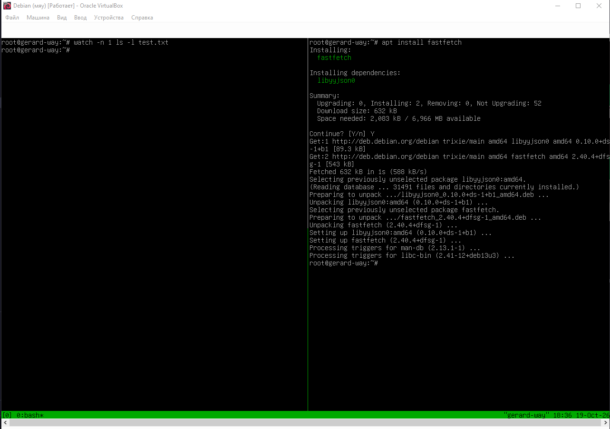
 
<small><em>Рисунок 11. разделение окна, установка fastfetch </em></small>

### **1.12.**

* ☼ Перейдите в левую область и после окончания установки запустите fastfetch.

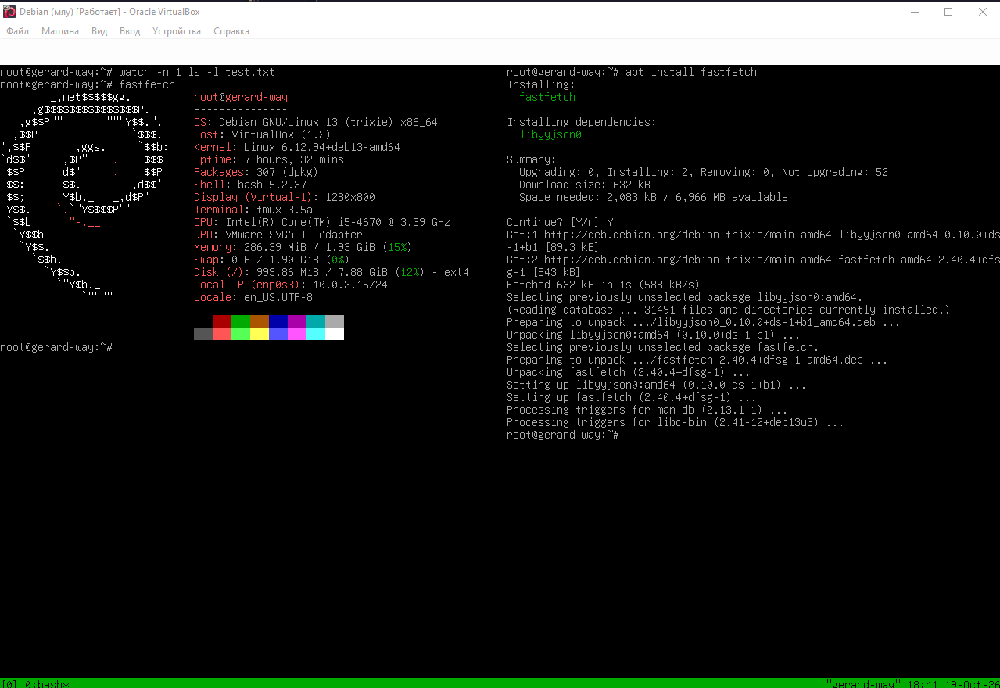
 
<small><em>Рисунок 12. запуск fastfetch в левой области </em></small>

### **1.13.**

* ☼ Закройте правую область командой exit.

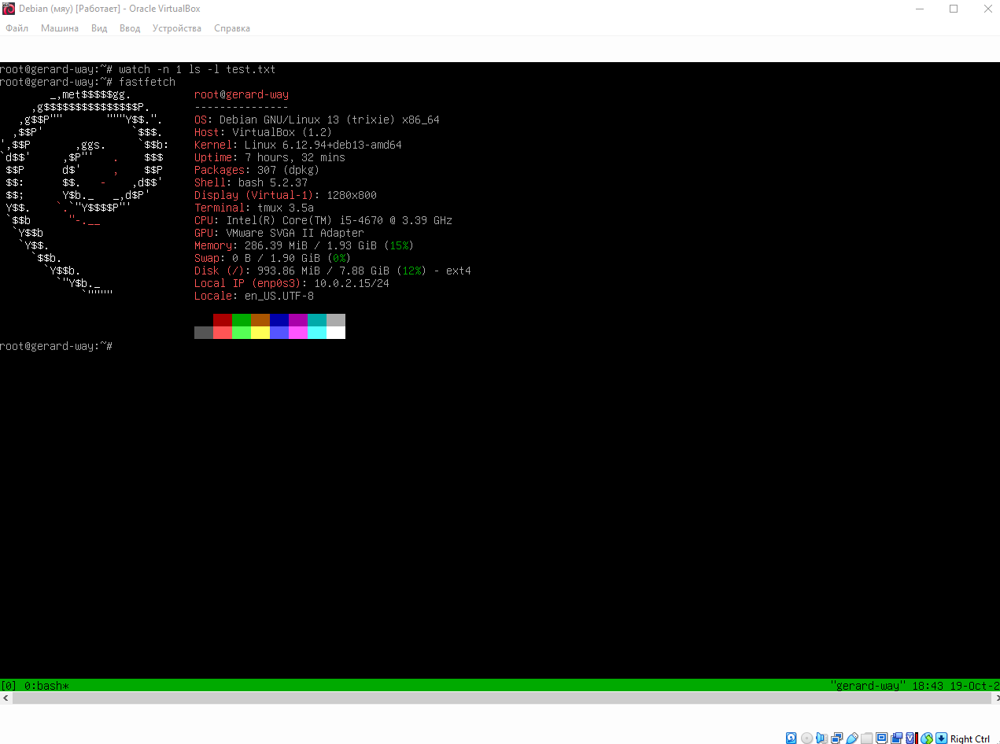
 
<small><em>Рисунок 13. правая область закрыта </em></small>

### **1.14.**

* ☼ Ради эксперимента, разделите окно по вертикали с помощью Ctrl + B и клавиши " (двойные кавычки). Деление можно выполнять последовательно по горизонтали и вертикали.

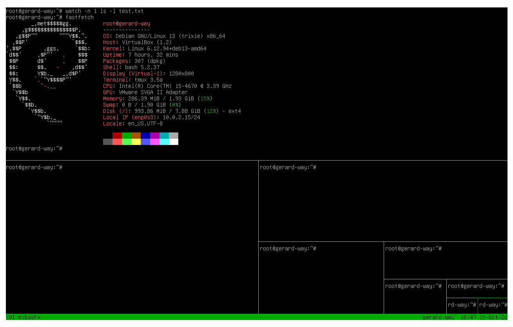
 
<small><em>Рисунок 14. делить, делить </em></small>

### **1.15.**

* ☼ По окончании закройте все области командами exit.

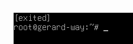
 
<small><em>Рисунок 15. все закрыто :( </em></small>

  ## **ВЫВОДЫ**

  **В ходе выполнения домашнего задания было изучено, как работать с мультиплексором `tmux`, создавать, переименовывать и переключатся между окнами, а также разделять рабочей области по вертикали и горизонтали. Это позволяет эффективно организовывать многозадачность в рамках одной терминальной сессии.**

