

# ДОМАШНЕЕ ЗАДАНИЕ
## ПО ДИСЦИПЛИНЕ «ОПЕРАЦИОННЫЕ СИСТЕМЫ И СРЕДЫ»
### **Тема: «Демон на стороне системы»** 

>Создание системного сервиса

| | |
| :--- | :--- |
| Студент: | Станчинская София Антоновна |
| Группа: | 9/2-РПО-25/3 (РПО9-3) |
| Дата: | 17.10.2026 |
| Преподаватель: | Штейнберг Эмиль Эдуардович |

## **Задание 0. <u>Создание скрипта</u>**

* ☼ Создайте программу, которая будет раз в несколько секунд писать в системный журнал (syslog), что данная программа активна. При запуске программы в журнал должна заноситься информация о событии запуска, при завершении (сигналы SIGTERM и SIGINT) — о событии завершения.
  * >Можно написать скрипт на Bash: для реализации вам понадобятся команды logger (для вывода информации в журнал), trap (для установки команды при получении сигнала) и sleep (для задержки выполнения программы).

  | | |
  |:---|:---|
  |`logger -p local3.info -t script_for_demon "..."`|  |
  | `logger` | записывает сообщений в системный журнал|
  |`-p` |(--priority) занести сообщение в журнал с указанным приоритетом. |
  | `local3.info` | приоритет (почта, информационное сообщение) |
  | `-t`| (--tag) помечать каждую записываемую в лог строку указанным тегом. |
  |`script_for_demon` |тэг, название данного скрипта |
  |`"..."`| тело лога, сообщение |

  * `stop_stalking()` функция завершения скрипта, она отправляет предсмертный лог и завершает работу

  * `trap 'stop_stalking' SIGINT SIGTERM` ловушка, если придет какой-то из написанных сигналов, активировать функцию stop_stalking

  * `logger -p local3.info -t script_for_demon "Daemon came to life and started stalking"` отправляет лог о том что демон успешно запущен
  * `while true; do` начало бесконечного цикла
  * `logger -p local3.info -t script_for_demon "AHAHAHA, I'm here, human!!!"` отправляет лог о том что демон работает
  * `sleep 5;` засыпание на 5 секунд, и затем цикл повторяется снова, лог отсылается снова.
  * `done` конец тела цикла

    vim script_for_demon.sh

  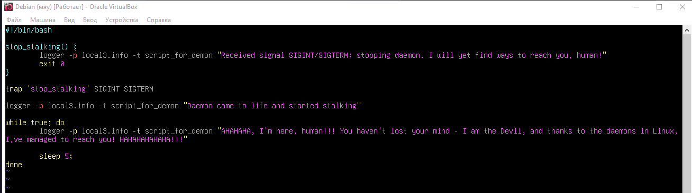
   
  <small><em>Рисунок 1. Создание директории ~/.config/systemd/user/ на стороне пользователя, так же переход в нее с помощью cd</em></small>

>успеть успеть успеть

## **Задание 1. <u>Практика по демонам. Сторона пользователя</u>**

### **1.1.**

* ☼ Создайте директорию ~/.config/systemd/user/, если его еще не существует.

  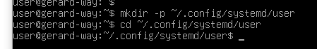
   
  <small><em>Рисунок 1. Создание директории ~/.config/systemd/user/ на стороне пользователя, так же переход в нее с помощью cd</em></small>

### **1.2.**

* ☼ Создайте внутри нее файл с произвольным названием с расширением .service. В таком случае, systemd определит название демона как имя данного файла до расширения .service. Пример: example.service — имя демона будет «example».

    vim stalker_demon.service

  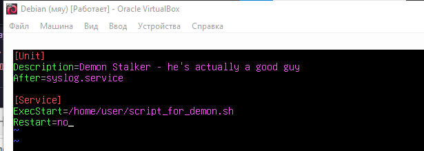
   
  <small><em>Рисунок 2. stalker_demon.service  </em></small>

### **1.3-4.**

* ☼ Теперь данный демон можно запустить на стороне пользователя. Для начала, надо дать systemd понять, что у нас изменились настройки, и их следует применить. Для этого systemd надо перезапустить: systemctl--user daemon-reload

* ☼ Теперь данный демон можно запустить на стороне пользователя. Для начала, надо дать systemd понять, что у нас изменились настройки, и их следует применить. Для этого systemd надо перезапустить: systemctl--user daemon-reload

    systemctl --user daemon-reload

    systemctl --user status stalker_demon
 

  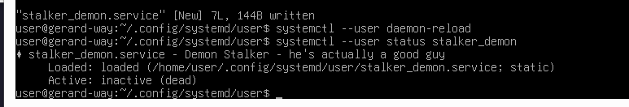
   
  <small><em>Рисунок 3-4. перезапуск systemd и проверка статуса демона </em></small>

### **1.5-6.**

* ☼ Запускаем демон: systemctl--user start {имя}
* ☼ Убедитесь, что демон запущен: systemctl--user status {имя}

    systemctl --user start stalker_demon

    systemctl --user status stalker_demon
 

  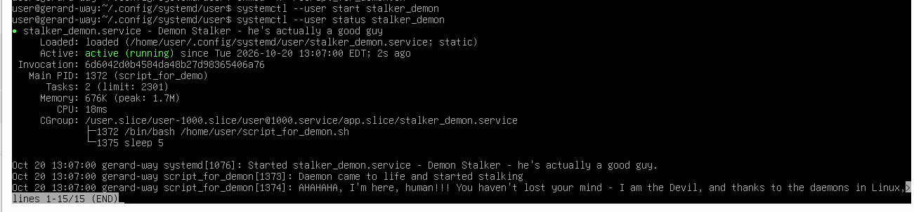
   
  <small><em>Рисунок 5-6. запуск демона и проверка его статуса  </em></small>

### **1.7.**

* ☼ Прочитайте файл /var/log/syslog, и убедитесь, что сообщения от вашего демона попадают в журнал. Можно воспользоваться командой со Слайда 6.

  >команда со слайда 6 не сработала, так что взяла эту

    journalctl --user -u stalker_demon -n 10

  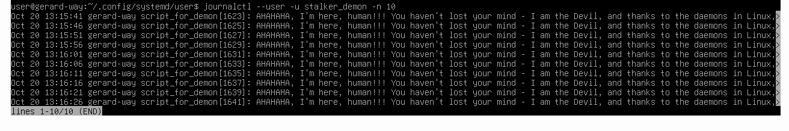
   
  <small><em>Рисунок 7.1 проверка журнала  </em></small>

  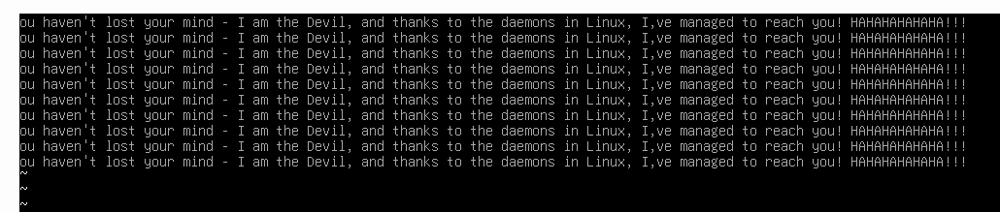
   
  <small><em>Рисунок 7.2 еще кусочек :) </em></small>

### **1.8.**

* ☼ Для остановки демона воспользуйтесь командой systemctl--user stop {имя}
* ☼ Убедитесь, что демон остановлен, и в журнале есть сообщение о 
прекращении его работы.

  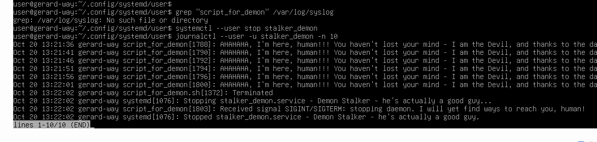
   
  <small><em>Рисунок 8. остановка демона, проверка журнала  </em></small>

## **Задание 2. <u>Практика по демонам. Сторона системы</u>**

### **1.1.**

* ☼ Войдите в сеанс суперпользователя. Либо выполняйте все нижеперечисленные команды с использованием sudo.
* ☼ Скопируйте созданный вами конфигурационный файл демона из ~/.config/systemd/user/ в директорию /etc/systemd/system/ или /usr/lib/systemd/system/. Его имя следует изменить, чтобы в системе не было двух одинаковых демонов, несмотря на то что запуск контролируется системой, а не пользователем.
* ☼ Скопированный файл необходимо будет отредактировать. Откройте его, для того чтобы поменять некоторые свойства.

    cp /home/user/.config/systemd/user/stalker_demon.service /etc/systemd/system/stalker_sys_demon.service

  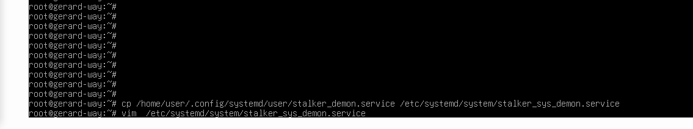
   
  <small><em>Рисунок 1. вход от root, копирование конф. файла демона, открытие для редактирования</em></small>

### **1.2.**

* ☼ Секцию Service надо дополнить информацией о пользователе и рабочей директории демона.
* ☼ В секции Install указывается системная цель, при которой осуществляется 
запуск демона.

  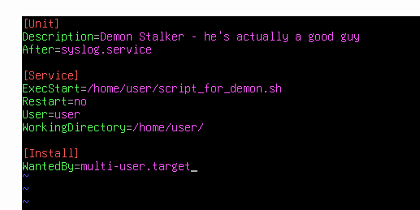
   
  <small><em>Рисунок 2. редактирование файла конфигурации на стороне суперпользователя</em></small>

### **1.3.**

* ☼ Аналогично, данный демон необходимо инициализировать в systemd: systemctl daemon-reload
* ☼ Теперь можно посмотреть, распознается ли по имени созданный демон: systemctl status {имя}

  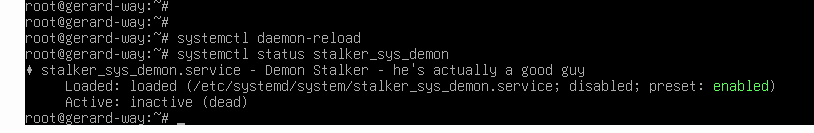
   
  <small><em>Рисунок 3. инициализация демона в systemd, проверка статуса демона. disabled отображается </em></small>

### **1.4.**

* ☼ Чтобы система могла этот демон запускать автоматически, необходимо его включить: systemctl enable {имя}
* ☼ Перезапустите систему командой reboot и убедитесь, что демон 
запустился автоматически.

    systemctl enable stalker_sys_demon

    reboot

  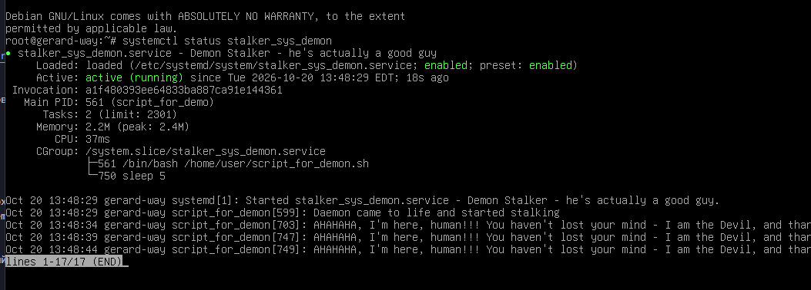
   
  <small><em>Рисунок 4. Проверка статуса демона после перезагрузки. Запустился сам </em></small>

### **1.5.**

* ☼ Прочитайте файл /var/log/syslog, и убедитесь, что сообщения от вашего демона попадают в журнал. Можно воспользоваться командой со Слайда 6.

    journalctl -u stalker_sys_demon -n 10

  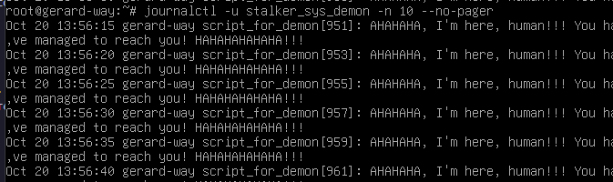
   
  <small><em>Рисунок 5. проверка журнала. сообщения от демона попадают в журнал </em></small>

### **1.6.**

* ☼ Снова перезапустите систему. Убедитесь, что в журнале есть сообщение о прекращении его работы перед выключением, и запуске при старте системы.

  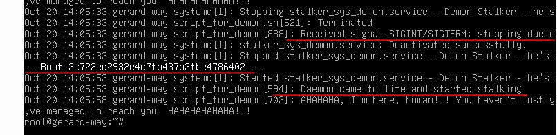
   
  <small><em>Рисунок 6. Журнал после перезагрузки </em></small>

### **1.7.**

* ☼ Автоматический запуск демона можно выключить с использованием команды systemctl disable {имя}

    systemctl disable stalker_sys_demon

  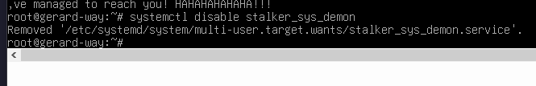
   
  <small><em>Рисунок 7. Выключение автоматического запуска демона </em></small>

  ## **ВЫВОДЫ**

  **В ходе выполнения лабораторной работы было изучено устройство демонов в операционной системе Linux, а также механизмы управления ими с помощью `systemd`. В результате работы были успешно созданы, протестированы и задокументированы два типа конфигураций: демон на стороне обычного пользователя и общесистемный демон на стороне системы с автозапуском. Это позволяет эффективно автоматизировать работу программ в фоновом режиме***

