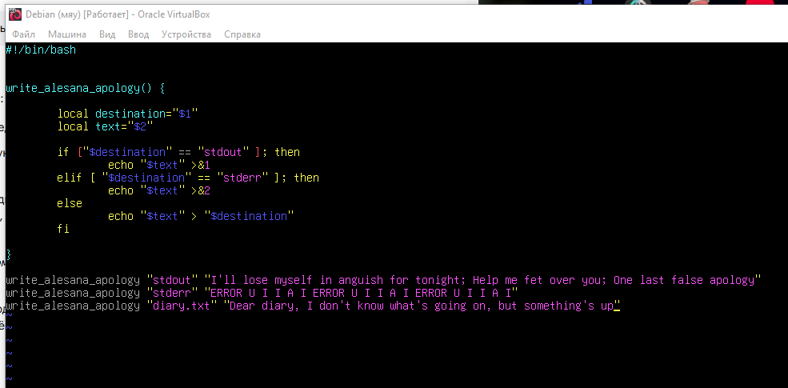
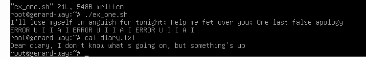
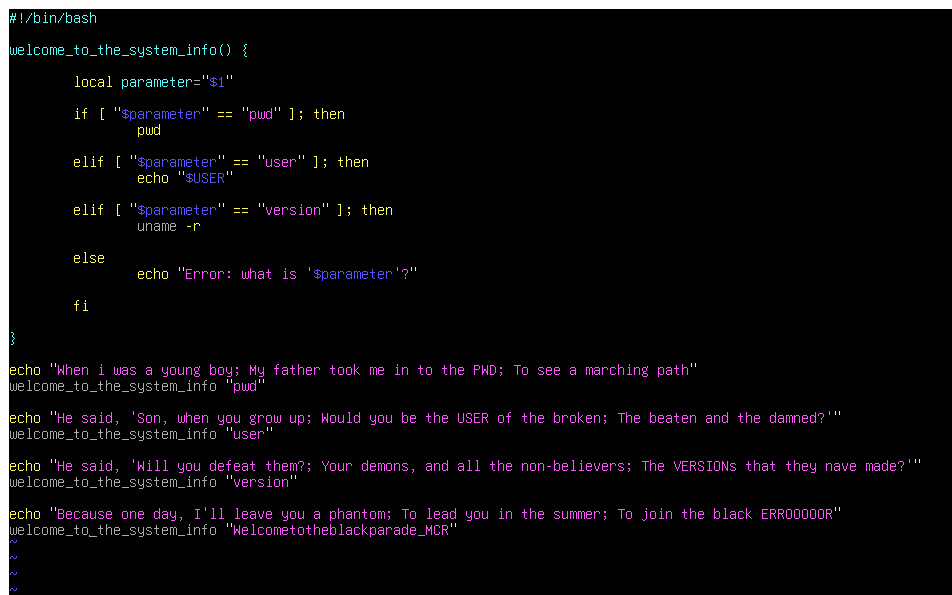
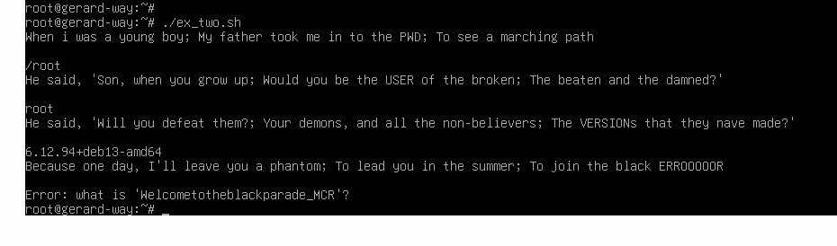
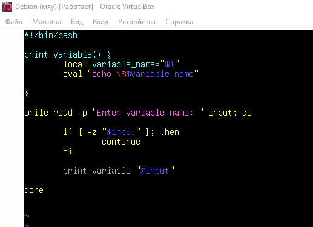
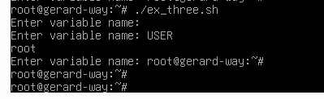

# ДОМАШНЕЕ ЗАДАНИЕ
## ПО ДИСЦИПЛИНЕ «ОПЕРАЦИОННЫЕ СИСТЕМЫ И СРЕДЫ»
### **Тема: «Функции в Bash»** 

>Использование функций в Bash

| | |
| :--- | :--- |
| Студент: | Станчинская София Антоновна |
| Группа: | 9/2-РПО-25/3 (РПО9-3) |
| Дата: | 17.10.2026 |
| Преподаватель: | Штейнберг Эмиль Эдуардович |

## **Задание 1. <u>Как вы думаете в чем отличие использования команд exit от return?</u>**

* exit - завершает весь скрипт, можно указать код ошибки
* return - завершает функцию внутри скрипта, можно указать код ошибки, скрипт выполняется дальше

## **Задание 1. <u>Практика по командам</u>**

### **1.1.**

* ☼ Напишите функцию, которая выводит текст в заданный в аргументе пользователем поток (стандартный поток вывода, стандартный поток ошибок, файл).

  * 2 локальные переменные, пункт назначения и текст
  * если пункт назначения = стандартный поток вывода, то эхо текст перенаправить в стандартный поток вывода
  * если пупнкт назначения = стандартный поток ошибок, то эхо текст перенаправить в стандартный поток ошибок
  * иначе эхо текст перенаправить в пункт назначения

  
   

  <small><em>Рисунок 1.1. скрипт bash </em></small>

   

  
   
   
  <small><em>Рисунок 1.2 запуск скрипта </em></small>

### **1.2.**

* ☼ Напишите функцию, которая будет выводить текущую информацию о системе. Функция должна принимать аргумент в виде описания запрошенного параметра (например, рабочая директория — pwd, текущий пользователь —user, версия — version и т.д.). Покажите использование функции.

  * 1 локальная переменная, параметр
  * если параметр = pwd, то запустить комманду pwd
  * если параметр = user, то запустить комманду $USER
  * если параметр = version, то запустить комманду uname -r (версия ядра)
  * иначе ошибка - неизвестный параметр

  
   

  <small><em>Рисунок 2.1. скрипт bash </em></small>

   

  
   
   
  <small><em>Рисунок 2.2 запуск скрипта </em></small>
  

### **1.3.**

* ☼ Напишите функцию, которая выводит значение переменной по ее названию. Для реализации используйте команду eval. Напишите с ней программу для вывода значения переменных по имени. Она должна выполняться до отправки в терминал комбинации клавиш Ctrl + D (состояние EOF стандартного потока ввода).

  * функция
  * 1 локальная переменная, имя переменной
  * строка эхо $имяпеременной (добавляется $)
  * eval превращает эту строку в код 
  * 
  * начало цикла
  * прочитать (вывести подсказку пользователю) то что написал пользователь, сохранить в переменную input
  * если длина переменной input равно 0, то продолжить (цикл идет заново)
  * вывести с помощью print_variable переменную input

  
   

  <small><em>Рисунок 3.1. скрипт bash </em></small>

   

  
   
   
  <small><em>Рисунок 3.2 запуск скрипта </em></small>
  

  ## **ВЫВОДЫ**

  **...**

