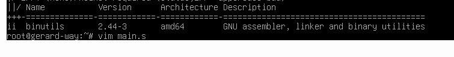
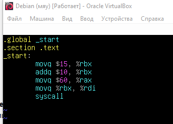
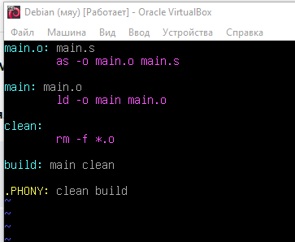
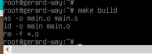

# ДОМАШНЕЕ ЗАДАНИЕ
## ПО ДИСЦИПЛИНЕ «ОПЕРАЦИОННЫЕ СИСТЕМЫ И СРЕДЫ»
### **Тема: «Автоматизация сборки Unix Makefiles»** 

>Как быстро собрать программу одной командой

| | |
| :--- | :--- |
| Студент: | Станчинская София Антоновна |
| Группа: | 9/2-РПО-25/3 (РПО9-3) |
| Дата: | 17.10.2026 |
| Преподаватель: | Штейнберг Эмиль Эдуардович |

## **Задание 1. <u>Практика</u>**

### **1.1.**

* ☼ Предварительная установка пакета binutils и создание файла main.s

  
   
  <small><em>Рисунок 1.1 установленный binutils, и создание vim main.s </em></small>

   

  
   
   
  <small><em>Рисунок 1.2 код в main.s (взят из презентации с пары) </em></small>
  

### **1.2.**

* ☼ Makefile для сборки приложения будет иметь следующий компактный вид.

 
<small><em>Рисунок 2. Запись кода в Makefile </em></small>

### **1.3.**

* ☼ Укажем абстрактную цель build. Тогда команда make build начнет выполнять цель main (сначала проверит зависимость main.o, та, в свою очередь, — изменение файла main.s, и при необходимости последовательно вызовет компилятор as и компоновщик ld), а затем выполнит цель clean (для удаления объектных файлов).

    make build

 
<small><em>Рисунок 3. make build </em></small>

  ## **ВЫВОДЫ**

  **В ходе выполнения домашнего задания было изучено, как работать с утилитой автоматизации сборки `make` и конфигурировать файлы `Makefile`.  Это позволяет собирать программу на ассемблере и очищать папку от лишних файлов одной командой. Полученные навыки необходимы для оптимизации, ускорения разработки и автоматизации сборки приложений в Linux.**

